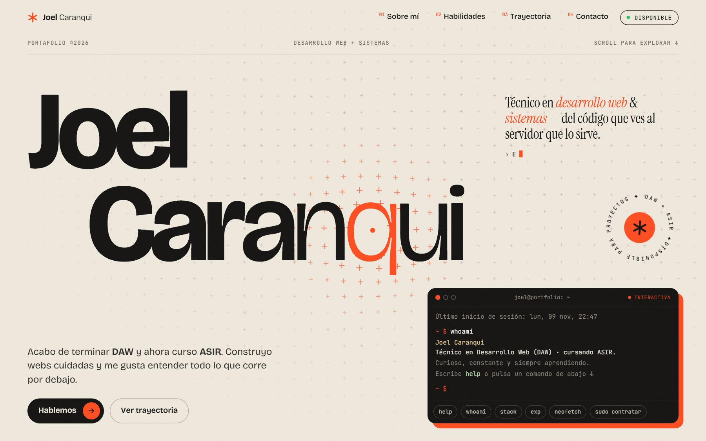

# Joel Caranqui — Portafolio

Portafolio personal de **Joel Caranqui**, técnico en Desarrollo de Aplicaciones Web (DAW) y estudiante de Administración de Sistemas Informáticos en Red (ASIR).

🔗 **[joeldev.is-a.dev](https://joeldev.is-a.dev)**

[](https://joeldev.is-a.dev)

## Qué tiene

- **Terminal interactiva** en la portada: prueba `help`, `whoami`, `stack`, `neofetch` o `sudo contratar`.
- Tipografía variable que reacciona al cursor y un fondo de cruces interactivo hecho con `<canvas>`.
- Animaciones al hacer scroll: textos que se revelan, tarjetas apiladas, contadores y marquesinas que siguen la velocidad del scroll.
- Diseño adaptable de móvil a pantallas grandes.
- Accesible: navegación por teclado, enlace para saltar al contenido y respeto a la preferencia de "reducir movimiento" del sistema.
- Email protegido frente a bots que recogen direcciones.
- Página 404 personalizada.

## Tecnologías

HTML, CSS y JavaScript, sin frameworks, sin librerías de animación y sin paso de compilación.

Recursos externos: [Google Fonts](https://fonts.google.com) (Bricolage Grotesque, Instrument Serif y JetBrains Mono) y [Font Awesome](https://fontawesome.com) para los iconos.

## Estructura

```
├── index.html          # Página principal
├── 404.html            # Página de error
├── CNAME               # Dominio personalizado
└── assets/
    ├── css/main.css    # Estilos
    ├── js/main.js      # Interacciones y animaciones
    ├── img/portada.jpg # Captura para este README
    ├── img/og.jpg      # Vista previa al compartir el enlace
    └── favicon.svg
```

## Ver en local

No hace falta instalar nada. Desde la carpeta del proyecto:

```bash
python -m http.server 8000
```

Y abre `http://localhost:8000`.

## Publicación

Se publica con **GitHub Pages** desde la rama `main`. El dominio personalizado se configura en el archivo `CNAME`.

---

© Joel Caranqui · [LinkedIn](https://www.linkedin.com/in/joel-caranqui/)
